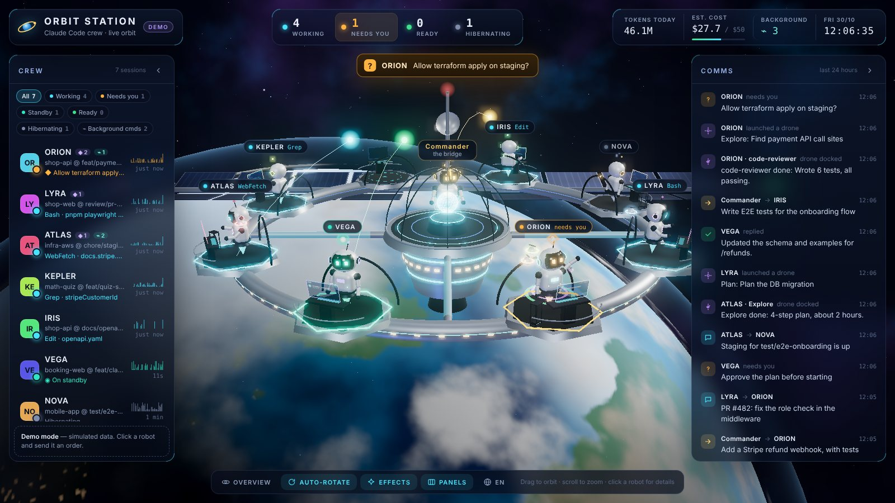
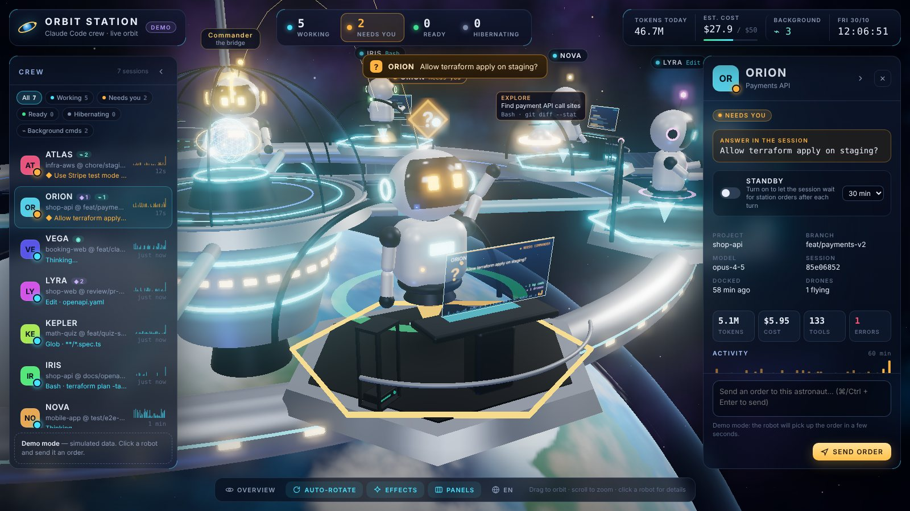

# 🛰 claude-agents-orbit-station-view

**Orbit Station** — a space station for your Claude Code sessions.

[Tiếng Việt](README.vi.md)

Orbit Station ("Trạm Orbit" in Vietnamese) turns the Claude Code sessions running on your machine into a live 3D space station. Every session is a robot astronaut at its own module on the station ring; you are the commander at the bridge in the middle.



- **Working** robots type at their consoles while a hologram shows the tool being run.
- Robots that **need you** (a permission prompt, a plan to approve, a question) wave their arm under an amber `?`, and an alert bar appears.
- **Idle** robots relax, and **hibernating** ones doze off with `z z`.
- Every **subagent** (Task/Agent) is a drone that launches from its robot, circles while it works and docks when it's done.
- **Background commands** (`run_in_background`, timed-out commands, Ctrl+B) are blades in a server rack next to the desk, with the last lines of their output.
- Orders, replies and messages between sessions fly between modules as glowing packets.



Click a robot to fly to it and open its detail panel. The panel shows:
- the current tool, tokens and estimated cost for today, and a 60-minute activity chart;
- the latest prompt and reply, with a full-text reader that renders markdown;
- a summary of the current turn (commands run, files edited with `+added −removed` lines, elapsed time) and the session's to-do list, read from `TodoWrite` and `update_plan` calls;
- the tool log, subagents and background commands;
- a box to **send an order** to that session.

The UI is available in **English and Vietnamese**. Switch with the globe button in the bottom dock; the choice is remembered per browser. Without a saved choice, the UI follows `"lang"` in `config.json`, then the browser language.

> **Unofficial.** This project is not affiliated with Anthropic. It reads Claude Code's local transcript files (`~/.claude/projects/**/*.jsonl`), whose format is undocumented and may change between versions.

## Quick start

You need **Node.js 18+** and Claude Code. There is no `npm install` step: three.js ships pre-bundled in `public/vendor/`.

```bash
git clone https://github.com/<you>/claude-agents-orbit-station-view.git
cd claude-agents-orbit-station-view
npm run demo     # try it with a simulated crew
npm start        # watch your real Claude Code sessions
```

Open **http://localhost:7799**. On macOS you can also double-click `start.command`; it starts the station, or restarts it if it's already running, and opens the browser.

| Key | Action |
|---|---|
| `1`–`9` | Fly to robot *n* |
| `0` / `Esc` | Back to overview |
| `[` / `]` | Collapse / expand the left / right panel |
| `H` | Hide / show both panels |
| `N` | Open a new Claude Code session |
| `S` | Usage stats (tokens and cost) |
| `⌘/Ctrl + Enter` | Send order |

Status filters can be combined (for example Working + Needs you). Alt-click a filter to show only that status.

## Opening a new session from the UI

The **New session** button in the bottom dock (or the `N` key) opens a Claude Code session without leaving the station:

- **Project folder:** type an absolute path, or click one of the recent folders (taken from the sessions the station has seen and from `projects` in `config.json`).
- **Terminal window** (default, macOS only): opens a new Terminal window running `claude` in that folder. This is a normal interactive session; the first time, macOS asks whether to let Node control Terminal.
- **Claude desktop app** (macOS): opens the app's new-session screen through its `claude://code/new` link, with the folder and the prompt pre-filled. You press send in the app. Unlike the two CLI modes, these sessions show up in the app's Code tab.
- **Background:** runs `claude --bg "<prompt>"` and needs a first prompt. Check on it with `claude attach <id>`. Background sessions may not share your interactive login, so a "Login expired" reply is possible.
- The **first prompt** is optional in Terminal mode. The new robot docks once the session has its first activity.

## Usage stats

The **Stats** button (or `S`) shows, for the last 30 days or the current month: total tokens, estimated cost, average per active day, the peak day, sessions and subagents, a cost-per-day chart, the split between input, output and cache tokens, and the top models and projects.

The numbers come from all Claude Code transcripts on the machine, regardless of the `projects` filter. Transcripts are large (gigabytes), so the station reads them in chunks and caches each file's result in `data/month-cache.json`: the first scan takes about 30 s, later refreshes only read what changed. Costs are estimates from `prices` in `config.json`, not an invoice.

## Dispatching orders with hooks (recommended)

Monitoring works out of the box. To get instant signals and to send orders to sessions, install the hooks:

```bash
npm run hooks:install     # backs up, then adds hooks to ~/.claude/settings.json
npm run hooks:status
npm run hooks:uninstall   # removes only this project's hooks
```

Sessions opened **before** you install pick up the hooks after a restart, or after typing `/hooks` in a terminal session.

How an order reaches a session:
- **Working session:** the order is delivered when the session finishes its current turn (`Stop` hook), and the agent continues straight away.
- **Idle session:** the order is attached to the next message you type in that session (`UserPromptSubmit` hook).
- **Standby mode:** turn it on per session in the detail panel and choose 15, 30 or 55 minutes. When that session finishes a turn, the `Stop` hook waits for orders instead of stopping:
  - An order arrives: the agent picks it up within 1–2 s. No extra tokens are spent while it waits.
  - You type in that session: the hook notices the queued message in the transcript and yields immediately.
  - Esc, switching standby off, or the timeout: the session stops normally.

When the agent finishes, the order is marked **done** and its final reply is attached as the result.

> Hooks run for every Claude Code session on the machine (about 50 ms per tool call) and exit immediately when the station isn't running.

### Optional: MCP tools for agents

```bash
npm run mcp:install   # = claude mcp add --scope user orbit -- node <path>/mcp/server.js
```

The agents get these tools:
- `orbit_inbox`: read orders for this session.
- `orbit_done`: report an order as done.
- `orbit_send`: message another robot by call sign.
- `orbit_report`: send a report to the bridge.
- `orbit_crew`: list the crew.

### Optional: waking idle sessions (off by default)

`"wake": true` in `config.json` lets the station run `claude --bg --resume <session> "<order>"` for idle sessions. If that session is open somewhere else (the desktop app or a terminal), Claude Code runs the order in a **forked copy** instead. The copy reloads the whole context (extra tokens) and does not sync back to the original session. Leave this off unless you understand the trade-off.

## Configuration (`config.json`, created on first run)

| Key | Default | Meaning |
|---|---|---|
| `lang` | `auto` | `en`, `vi` or `auto`. Sets the default UI language, plus the language of server messages and the demo crew. Orders reach agents in the language of the UI they were sent from. `auto` follows the browser for the UI and the OS locale for the server. Override with `ORBIT_LANG=en npm start` |
| `title` | Trạm Orbit | Station name (the default is shown translated) |
| `commander` | Chỉ huy | Your name on the bridge (the default is shown translated) |
| `commanderTitle` | *(empty)* | Title under your name at the centre of the station, e.g. `"CEO"` or `"Tech Lead"`. Empty shows "the bridge" (translated). Max 40 characters |
| `projects` | `[]` | Only watch these folders (including subfolders); empty = all projects |
| `keepHours` | 12 | Sessions silent for longer leave the station |
| `hide` | `[]` | Session id prefixes to hide |
| `crew` | `[]` | Custom call signs, e.g. `{ "match": "85e06852", "name": "ORION", "role": "Backend" }` |
| `dailyBudgetUsd` | 50 | Daily cost bar (turns red at 80%) |
| `prices` | opus 5/25 · sonnet 3/15 · haiku 1/5 | USD per 1M input/output tokens, used for **estimates** only (cache read 0.1×, cache write 1.25× / 2× for 1 h) |
| `wake`, `claudePath`, `wakePermissionMode` | false, auto, acceptEdits | Waking idle sessions, see above |
| `port` | 7799 | Override temporarily with `ORBIT_PORT=7800 npm start` |

Call signs are assigned automatically (ORION, VEGA, LYRA…). A session renamed with `/rename` keeps that name.

## Security

- The server listens on `127.0.0.1` only and checks the `Host` header, which blocks DNS rebinding.
- State-changing requests require three things: a per-run page token, a matching `Origin`, and `Content-Type: application/json`. Other websites cannot post orders (no CSRF).
- Opening a session (`/api/launch`) is one of those state-changing requests. The folder must be an absolute path to an existing directory, and the prompt is passed as a process argument in background mode, or single-quoted into the Terminal command line.
- Hooks authenticate with a secret in `data/.hook-secret` (mode 600) and only send tool summaries, never tool contents.
- Text that looks like API keys or tokens is masked before display.
- Nothing is sent off your machine. Web fonts are loaded from Google Fonts, and the UI falls back to system fonts offline.

## Platform support

Developed on macOS with Node 18–24. Linux should work the same way. Windows is untested: the hooks and paths are written to be portable, but `start.command` is macOS-only.

## Project layout

```
server.js            HTTP + SSE server, inbox, hook endpoint
lib/claude.js        parses ~/.claude/projects/*.jsonl → status, tokens, tools, subagents
lib/bgtasks.js       background commands and their output tails
lib/inbox.js         order inbox (data/inbox.jsonl)
lib/launch.js        opens new sessions (Terminal window or claude --bg)
lib/month.js         30-day / monthly token and cost stats, cached per transcript
lib/standby.js       standby mode settings
lib/demo.js          simulated crew for `npm run demo`
lib/i18n.js          server-side strings (orders, errors, console)
scripts/hook.js      the Claude Code hook (signals, order delivery, standby)
scripts/hooks.js     install / uninstall / status for hooks
mcp/server.js        stdio MCP server with orbit_* tools
public/              UI: three.js scene, robots, HUD
public/js/i18n.js    UI strings (en / vi); add a block there to add a language
```

## License

[MIT](LICENSE) © 2026 Peter. three.js is MIT-licensed; see [THIRD_PARTY_NOTICES.md](THIRD_PARTY_NOTICES.md).
