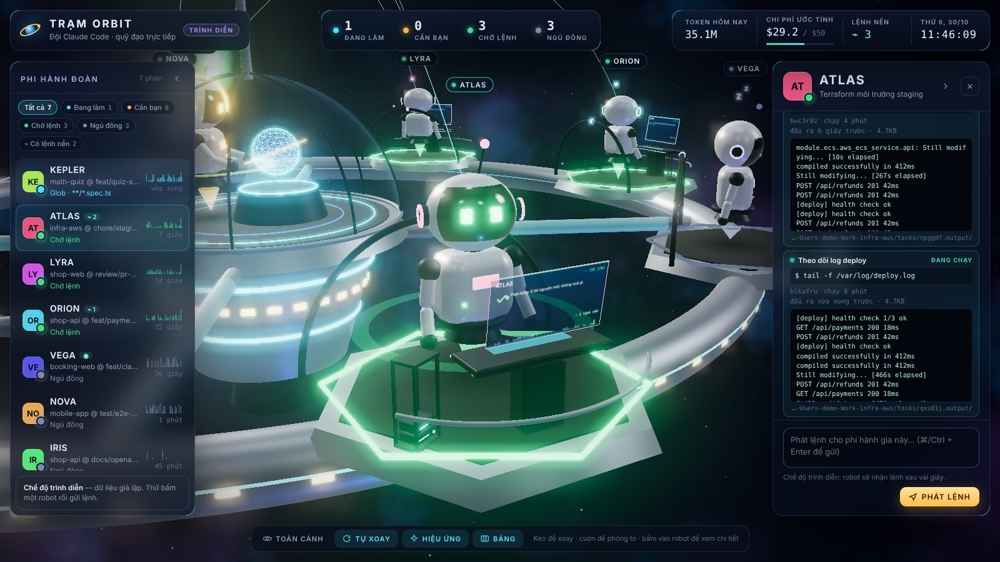

# 🛰 claude-agents-orbit-station-view

**Trạm Orbit** (Orbit Station)

[English](README.md)

Trạm vũ trụ 3D cho đội Claude Code trên máy của bạn. Mỗi phiên Claude Code là một robot phi hành gia có module riêng trên vành trạm. Bạn là chỉ huy, đứng ở đài chỉ huy giữa trạm.


- Robot **đang làm**: gõ phím, màn hình hologram chạy mã, đèn ăng-ten nháy.
- Robot **cần bạn**: giơ tay vẫy, trên đầu hiện dấu `?` màu cam, thanh báo động hiện ở đầu màn hình.
- Robot **chờ lệnh**: thả lỏng, nhìn quanh. Robot **ngủ đông**: mắt khép, hiện `z z`.
- Mỗi **subagent** (Task/Agent) là một **drone**: bay ra từ ngực robot khi được phóng, bay vòng khi làm, bay về khi xong. Token của subagent được cộng vào phiên mẹ.
- **Lệnh chạy nền** (`run_in_background`, lệnh quá giờ, Ctrl+B) là các lưỡi máy chủ trên giá cạnh bàn, kèm vài dòng đầu ra cuối.
- Lệnh, báo cáo và tin nhắn giữa các phiên bay thành **gói tin phát sáng** giữa các module.



Bấm vào một robot để bay tới module của nó và mở khung chi tiết. Khung này có:
- Công cụ đang chạy, token và chi phí ước tính hôm nay, nhịp làm việc 60 phút.
- Lệnh và báo cáo gần nhất, kèm hộp đọc toàn văn hiển thị markdown.
- Tổng kết lượt hiện tại (số lệnh đã chạy, file đã sửa kèm `+thêm −bớt` dòng, thời gian) và danh sách việc của phiên, đọc từ các lệnh gọi `TodoWrite` và `update_plan`.
- Nhật ký công cụ, các drone và các lệnh nền.
- Ô **phát lệnh** cho phiên đó.

Giao diện có **tiếng Việt và tiếng Anh**. Đổi bằng nút hình quả địa cầu ở thanh dưới; trình duyệt sẽ nhớ lựa chọn. Nếu chưa chọn, giao diện theo `"lang"` trong `config.json`, sau đó theo ngôn ngữ trình duyệt.

> **Không chính thức.** Dự án không liên quan tới Anthropic. Trạm đọc nhật ký cục bộ của Claude Code (`~/.claude/projects/**/*.jsonl`). Định dạng này không có tài liệu và có thể đổi giữa các phiên bản.

## Chạy

Cần **Node.js 18+** và Claude Code. Không cần `npm install`: three.js đã được đóng gói sẵn trong `public/vendor/`.

```bash
git clone https://github.com/<bạn>/claude-agents-orbit-station-view.git
cd claude-agents-orbit-station-view
npm run demo     # xem thử với phi hành đoàn giả lập
npm start        # theo dõi các phiên Claude Code thật
```

Mở **http://localhost:7799**. Trên macOS có thể bấm đúp `start.command`: nó khởi động trạm (hoặc khởi động lại nếu trạm đang chạy) rồi mở trình duyệt.

| Phím | Tác dụng |
|---|---|
| `1`–`9` | Bay tới robot thứ n |
| `0` / `Esc` | Về toàn cảnh |
| `[` / `]` | Thu nhỏ / mở bảng trái / phải |
| `H` | Ẩn / hiện cả hai bảng |
| `N` | Mở phiên Claude Code mới |
| `S` | Thống kê sử dụng (token và chi phí) |
| `⌘/Ctrl + Enter` | Gửi lệnh |

Bộ lọc trạng thái chọn được nhiều cái cùng lúc (ví dụ Đang làm + Cần bạn). Alt+bấm để chỉ xem một trạng thái.

## Mở phiên mới từ giao diện

Nút **Phiên mới** ở thanh dưới (hoặc phím `N`) mở một phiên Claude Code mà không cần rời trạm:

- **Thư mục dự án:** gõ đường dẫn tuyệt đối, hoặc bấm một thư mục gần đây (lấy từ các phiên trạm đã thấy và từ `projects` trong `config.json`).
- **Cửa sổ Terminal** (mặc định, chỉ macOS): mở cửa sổ Terminal mới chạy `claude` trong thư mục đó. Đây là phiên tương tác bình thường; lần đầu macOS sẽ hỏi có cho Node điều khiển Terminal không.
- **App Claude desktop** (macOS): mở màn hình phiên mới của app qua link `claude://code/new`, điền sẵn thư mục và lệnh; bạn bấm gửi trong app. Khác với hai chế độ CLI, phiên này hiện trong tab Code của app.
- **Chạy nền:** chạy `claude --bg "<lệnh>"`, cần có lệnh đầu tiên. Xem lại bằng `claude attach <mã>`. Phiên nền có thể không dùng chung đăng nhập với phiên tương tác, nên có thể gặp "Login expired".
- **Lệnh đầu tiên** là tùy chọn khi mở bằng Terminal. Robot mới cập bến khi phiên có hoạt động đầu tiên.

## Thống kê sử dụng

Nút **Thống kê** (hoặc phím `S`) cho 30 ngày qua hoặc tháng này: tổng token, chi phí ước tính, trung bình mỗi ngày làm việc, ngày cao nhất, số phiên và subagent, biểu đồ chi phí theo ngày, tỷ lệ token input/output/cache, và các mô hình và dự án tốn nhất.

Số liệu lấy từ toàn bộ nhật ký Claude Code trên máy, không lọc theo `projects`. Nhật ký rất lớn (hàng GB) nên trạm đọc theo khối và nhớ kết quả từng file trong `data/month-cache.json`: lần quét đầu mất khoảng 30 giây, các lần sau chỉ đọc phần mới. Chi phí là ước tính theo `prices` trong `config.json`, không phải hóa đơn.

## Giao lệnh qua hooks (nên bật)

Trạm xem được ngay mà không cần cài gì. Muốn có tín hiệu tức thời và gửi lệnh cho phiên thì cài hooks:

```bash
npm run hooks:install     # sao lưu rồi thêm hooks vào ~/.claude/settings.json
npm run hooks:status
npm run hooks:uninstall   # chỉ gỡ hooks của dự án này
```

Phiên mở **trước** khi cài cần mở lại, hoặc gõ `/hooks` trong phiên ở terminal.

Lệnh tới phiên như sau:
- **Phiên đang làm:** lệnh được giao khi phiên xong lượt (hook `Stop`), agent làm tiếp luôn.
- **Phiên rảnh:** lệnh được kèm vào lần tới bạn gõ bất cứ gì vào phiên đó (hook `UserPromptSubmit`).
- **Trực lệnh:** bật công tắc trong khung chi tiết, chọn 15, 30 hoặc 55 phút. Khi phiên xong lượt, hook `Stop` chờ lệnh thay vì dừng ngay.
  - Có lệnh: agent làm ngay trong 1–2 giây, không tốn token khi chờ.
  - Bạn gõ vào phiên: hook thấy tin xếp hàng trong nhật ký và nhường ngay.
  - Bấm Esc, tắt công tắc hoặc hết giờ: phiên dừng như bình thường.

Khi agent xong, lệnh được đánh dấu **Xong**, kèm toàn văn câu trả lời cuối.

> Hook chạy cho mọi phiên Claude Code trên máy (khoảng 50 ms mỗi lần gọi công cụ). Trạm không chạy thì hook thoát ngay.

### Tùy chọn: công cụ MCP cho agent

```bash
npm run mcp:install   # = claude mcp add --scope user orbit -- node <đường dẫn>/mcp/server.js
```

Agent sẽ có các công cụ sau:
- `orbit_inbox`: xem lệnh gửi cho phiên này.
- `orbit_done`: báo xong một lệnh, kèm kết quả.
- `orbit_send`: nhắn robot khác theo tên hiệu.
- `orbit_report`: gửi báo cáo về đài chỉ huy.
- `orbit_crew`: xem cả phi hành đoàn.

### Tùy chọn: đánh thức phiên rảnh (tắt mặc định)

Đặt `"wake": true` trong `config.json` thì trạm sẽ chạy `claude --bg --resume <phiên> "<lệnh>"` cho phiên rảnh. Nếu phiên đó đang mở ở nơi khác (app hoặc terminal), Claude Code sẽ chạy lệnh trong một **bản sao** tách nhánh. Bản sao tốn thêm token để nạp lại ngữ cảnh và không đồng bộ với phiên gốc.

## Cấu hình `config.json` (tự tạo khi chạy lần đầu)

| Khóa | Mặc định | Ý nghĩa |
|---|---|---|
| `lang` | `auto` | `vi`, `en` hoặc `auto`. Là ngôn ngữ mặc định của giao diện, của thông báo máy chủ và phi hành đoàn trình diễn. Lệnh tới agent viết theo ngôn ngữ giao diện lúc bạn gửi. `auto` thì giao diện theo trình duyệt, máy chủ theo ngôn ngữ hệ điều hành. Đổi tạm bằng `ORBIT_LANG=vi npm start` |
| `title` | Trạm Orbit | Tên trạm |
| `commander` | Chỉ huy | Tên bạn trên đài chỉ huy |
| `commanderTitle` | *(trống)* | Chức danh dưới tên bạn ở giữa trạm, ví dụ `"CEO"` hoặc `"Tech Lead"`. Để trống thì hiện "đài chỉ huy" (tự dịch). Tối đa 40 ký tự |
| `projects` | `[]` | Chỉ theo dõi các thư mục này (gồm thư mục con); để trống là theo dõi mọi dự án |
| `keepHours` | 12 | Phiên im quá số giờ này thì rời trạm |
| `hide` | `[]` | Ẩn phiên theo vài ký tự đầu của mã phiên |
| `crew` | `[]` | Tên hiệu riêng, ví dụ `{ "match": "85e06852", "name": "ORION", "role": "Backend" }` |
| `dailyBudgetUsd` | 50 | Trần chi phí mỗi ngày (từ 80% thì thanh chuyển đỏ) |
| `prices` | opus 5/25 · sonnet 3/15 · haiku 1/5 | Giá USD trên 1 triệu token vào/ra, chỉ dùng để **ước tính** |
| `wake`, `claudePath`, `wakePermissionMode` | false, tự tìm, acceptEdits | Đánh thức phiên rảnh (xem ở trên) |
| `port` | 7799 | Đổi tạm bằng `ORBIT_PORT=7800 npm start` |

## Bảo mật

- Trạm chỉ nghe `127.0.0.1` và kiểm tra `Host` để chặn tấn công DNS rebinding.
- Mọi lệnh thay đổi trạng thái phải kèm mã trang (tạo mới mỗi lần chạy), `Origin` đúng và `Content-Type: application/json`. Trang web lạ không gửi lệnh vào được (chống CSRF).
- Mở phiên mới (`/api/launch`) cũng là một lệnh thay đổi trạng thái như trên. Thư mục phải là đường dẫn tuyệt đối tới một thư mục có thật, và lệnh được truyền làm tham số tiến trình khi chạy nền, hoặc đặt trong dấu nháy đơn khi đưa vào dòng lệnh Terminal.
- Hook xác thực bằng khóa bí mật trong `data/.hook-secret` (quyền 600) và chỉ gửi tóm tắt công cụ, không gửi nội dung.
- Các chuỗi giống khóa API hay token được che trước khi hiển thị.
- Không gửi dữ liệu ra ngoài máy. Riêng font chữ tải từ Google Fonts; nếu không có mạng thì trạm dùng font hệ thống.

## Nền tảng

Phát triển trên macOS với Node 18–24. Linux có lẽ chạy được như trên macOS. Windows chưa thử; riêng `start.command` chỉ dùng được trên macOS.

## Giấy phép

[MIT](LICENSE) © 2026 Peter. three.js dùng giấy phép MIT; xem [THIRD_PARTY_NOTICES.md](THIRD_PARTY_NOTICES.md).
